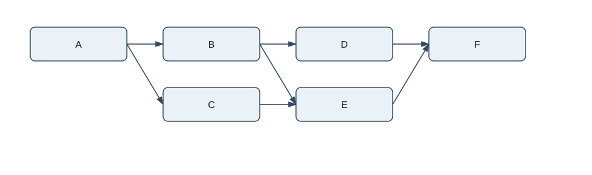
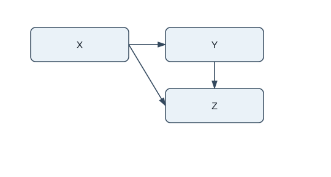
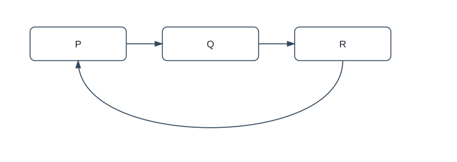

# ОТЧЁТ ПО ПРАКТИЧЕСКОЙ РАБОТЕ

**Дисциплина:** Конфигурационное управление  
**Тема:** Инструмент визуализации графа зависимостей менеджера пакетов  
**Вариант:** №23  
**Группа:** ИКБО-31-25  
**Учебный год:** 2026/2027  
**Выполнил(а):** ______________________________  
**Проверил:** П.Н. Советов

РТУ МИРЭА — 2026

---

## 1. Цель работы

Разработать простое CLI-приложение, которое получает зависимости пакетов
Alpine Linux из индекса APK, строит граф зависимостей без рекурсивного обхода,
находит обратные зависимости и формирует визуальное представление графа.

При получении информации о зависимостях не используются менеджеры пакетов
или сторонние библиотеки. Для загрузки архива в реальном режиме применяются
консольные `curl` и `tar`; сами данные разбираются собственным кодом на C++.

## 2. Реализация этапов

### Этап 1. Минимальный прототип с конфигурацией

Создано CLI-приложение на C++17. Параметры загружаются из файла `config.toml`.
Программа выводит каждый параметр в формате «ключ = значение».

Реализованы проверки:

- обязательности всех пяти параметров;
- формата имени пакета;
- наличия тестового файла либо корректности URL;
- значений `true` и `false` для логических параметров;
- целочисленного диапазона глубины от 0 до 100;
- неизвестных и повторяющихся ключей TOML.

Пример конфигурации:

```toml
package = "A"
repository = "test_repo.txt"
test_mode = true
ascii_tree = true
max_depth = 3
```

В тестовом режиме `repository` — путь к локальному файлу. В реальном режиме
это прямой URL к `APKINDEX.tar.gz`.

### Этап 2. Сбор данных

Выбран формат пакетов Alpine Linux APK. В реальном режиме команда `curl`
получает архив, а `tar` извлекает из него текстовый файл `APKINDEX`.
Затем собственный парсер считывает поля записей:

- `P` — имя пакета;
- `D` — список прямых зависимостей;
- `p` — предоставляемые пакетом имена;
- `k` — приоритет провайдера.

На этом этапе программа выводит прямые зависимости заданного пакета.
Вызовы `apk`, `apt`, `pip` или иных менеджеров пакетов в исходном коде
отсутствуют.

В проекте реализован разбор индекса `APKINDEX.tar.gz` (формат v2).
Формат нового индекса `Packages.adb` (v3) не реализован.

### Этап 3. Основные операции

Граф строится алгоритмом DFS без рекурсии. Для стека используется вектор,
в котором хранятся имя пакета и глубина его уровня. Корневой пакет имеет
глубину 0.

Для каждой вершины запоминается минимальная найденная глубина. Вершина
раскрывается повторно, если найден путь короче предыдущего. Благодаря этому
ограничение глубины не зависит от того, по какой ветви DFS впервые встретил
общую зависимость.

Если вершина уже была обработана на той же или меньшей глубине, повторный
обход прекращается. Поэтому циклические зависимости не вызывают бесконечный
цикл. Ребро, замыкающее цикл, остаётся в графе и показывается в визуализации.

При `max_depth = 2` включаются вершины уровней 0, 1 и 2. Зависимости вершин
уровня 2 не раскрываются. При `max_depth = 0` граф содержит только корневой
пакет.

### Этап 4. Обратные зависимости

Для построения обратного графа каждое ребро меняет направление:

`пакет -> зависимость` превращается в `зависимость -> пакет`.

После этого применяется тот же итеративный DFS и тот же параметр максимальной
глубины. В выводе перечисляются пакеты, достижимые от исходного пакета
по обратным рёбрам.

### Этап 5. Визуализация

Программа формирует файл `graph.puml` с PlantUML-описанием. Дополнительно
самостоятельно создаётся `graph.svg`, показывающий вершины и направленные рёбра.
В графической Linux-сессии файл SVG открывается через системный просмотрщик.
Если графическая сессия недоступна, изображение остаётся в `graph.svg` и
открывается вручную в браузере.

Если `ascii_tree = true`, печатается ASCII-дерево. Для повторно встреченной
вершины выводится пометка `[уже показан]`, а при возвращении в текущий путь —
`[цикл]`.

## 3. Тестовый репозиторий и демонстрация

В файле `test_repo.txt` описаны графы для нескольких сценариев. Пакеты
обозначены большими латинскими буквами, как требуется в задании.

### 3.1. Пакет A — ветвящийся граф

Прямые зависимости: `B`, `C`. Транзитивные зависимости: `D`, `E`, `F`.
Пакеты `B` и `C` используют общую зависимость `E`, а `D` и `E` — общую
зависимость `F`.



### 3.2. Пакет X — небольшой ациклический граф

Прямые зависимости: `Y`, `Z`. Пакет `Y` также зависит от `Z`.
Повторное появление `Z` в ASCII-дереве помечается как уже показанная вершина.



### 3.3. Пакет P — циклический граф

Зависимости образуют цикл: `P -> Q -> R -> P`. DFS завершается, все три
вершины и три ребра сохраняются. В ASCII-дереве повторное появление `P`
помечается как `[цикл]`.



### 3.4. Обратные зависимости

В тестовом файле заданы рёбра `U -> A` и `V -> U`. Для пакета `A` программа
находит обратные зависимости `U` и `V`. Для пакета `P` в цикле достижимы
обратные зависимости `Q` и `R`.

## 4. Проверка программы

Автоматические тесты запускаются через CTest. Они проверяют:

| Проверка | Ожидаемое поведение | Результат |
|---|---|---|
| Корректный TOML | Все пять значений считываются | Пройдено |
| Неверное имя пакета | Ошибка `package` | Пройдено |
| Неверный путь / URL репозитория | Ошибка `repository` | Пройдено |
| Неверный `test_mode` | Ошибка логического значения | Пройдено |
| Неверный `ascii_tree` | Ошибка логического значения | Пройдено |
| Отрицательная, слишком большая или текстовая глубина | Ошибка `max_depth` | Пройдено |
| Неизвестный / повторный ключ | Ошибка конфигурации | Пройдено |
| Ошибка структуры тестового графа | Ошибка чтения репозитория | Пройдено |
| Разбор полей APKINDEX `P`, `D`, `p`, `k` и выбор виртуального провайдера | Пройдено |
| Максимальная глубина 0 и 2 | Обрезка на заданном уровне | Пройдено |
| Общая зависимость и более короткий путь | Повторное раскрытие при меньшей глубине | Пройдено |
| Цикл `P -> Q -> R -> P` | Нет бесконечного обхода | Пройдено |
| Обратные зависимости `U -> A`, `V -> U` | Найдены `U` и `V` | Пройдено |

Команды проверки:

```bash
cmake -S . -B build
cmake --build build --parallel
ctest --test-dir build --output-on-failure
```

Результат контрольного запуска: `100% tests passed, 0 tests failed`.

## 5. Сравнение со штатными средствами Alpine APK

В Alpine предусмотрена команда `apk dot`, которая формирует граф зависимостей
в Graphviz DOT. Для просмотра прямых и обратных зависимостей также доступны
`apk info --depends` и `apk info --rdepends`.

По назначению результаты сравниваются следующим образом:

| Возможность | Разработанная программа | Штатная команда Alpine |
|---|---|---|
| Прямые зависимости | Да | `apk info --depends PACKAGE` |
| Обратные зависимости | Да, собственный обход по индексу | `apk info --rdepends PACKAGE` |
| Граф | PlantUML и SVG | `apk dot PACKAGE` (Graphviz DOT) |
| Ограничение глубины | Да, `max_depth` из TOML | Не предусмотрено отдельным параметром проекта |
| Тестовый граф из файла | Да | Не является режимом `apk dot` |
| Циклические рёбра | Обход завершается, ребро сохраняется | Штатная реализация использует собственный resolver |

Точные списки пакетов могут отличаться. Штатный APK resolver учитывает
совместимость архитектуры, ограничения версий, виртуальные `provides`,
приоритеты репозиториев и другие правила выбора пакетов. В данном учебном
проекте используется один выбранный индекс; виртуальные имена разрешаются
упрощённо — выбирается провайдер с наибольшим значением `k`, а сравнение
версий не реализуется. Поэтому для совпадающего сравнения нужно использовать
одинаковые репозиторий, архитектуру и пакет.

В среде подготовки проекта исполняемая команда `apk` отсутствовала, поэтому
не заявляется о выполненном побайтовом сравнении вывода штатной утилиты.
Для повторения сравнения на Alpine Linux выполните для того же пакета:

```bash
apk info --depends zlib
apk info --rdepends zlib
apk dot zlib > native.dot
```

Файлы `native.dot` и `graph.puml` описывают граф в разных языках диаграмм.

Официальные описания формата и команд:

- <https://github.com/alpinelinux/apk-tools/blob/master/doc/apk-package.5.scd>
- <https://man.archlinux.org/man/apk-dot.8.en>
- <https://man.archlinux.org/man/extra/apk-tools/apk-info.8.en>

## 6. Структура Git и коммиты

Разработка разделена на пять коммитов Conventional Commits:

1. `feat(config): add TOML-based CLI configuration`
2. `feat(apk): parse Alpine APKINDEX dependencies`
3. `feat(graph): build dependency graph with iterative DFS`
4. `feat(graph): add reverse dependency traversal`
5. `feat(output): generate PlantUML, SVG and ASCII tree`

## 7. Вывод

Разработан CLI-инструмент для анализа зависимостей Alpine APK. Программа
загружает параметры из TOML, поддерживает локальный тестовый репозиторий и
получение данных из APKINDEX, строит транзитивный граф итеративным DFS,
ограничивает глубину, обрабатывает циклы, находит обратные зависимости и
генерирует PlantUML, SVG и ASCII-дерево. Основные сценарии проверены
автоматическими тестами и тремя демонстрационными графами.
